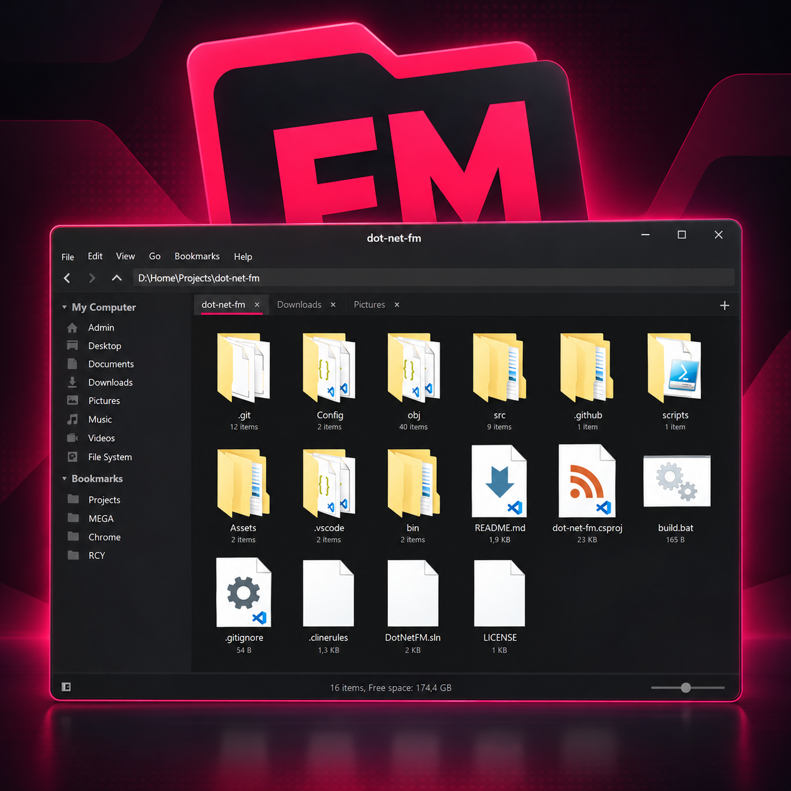

<p align="center">
  
</p>

<h1 align="center">DotNetFM</h1>

<p align="center">DotNetFM is a modern, Linux-inspired file manager for Windows, built from scratch with C# and WPF using a modular architecture — minimal, fast, and designed to bring the clean Nautilus-like desktop experience to Windows.</p>

<p align="center">
  
  
  
  
</p>

---

## Features

- Tabs. Saved and restored between sessions.
- Sidebar with places, drives and bookmarks. Resizable, collapsible.
- Recycle Bin browsing with restore and permanent delete.
- Archives: zip, tar, 7z, rar and more. Extracts through 7-Zip, NanaZip or WinRAR if installed.
- Rename in place, drag and drop, rubber-band select, type-ahead, Ctrl+wheel zoom.
- Configurable context menu and terminal command.
- Colors, radii, spacing and fonts live in `Config/theme-config.json`. No rebuild to restyle.

## Shortcuts

| Key | Action |
| --- | --- |
| `Ctrl+T` / `Ctrl+W` | New / close tab |
| `Ctrl+Tab` / `Ctrl+Shift+Tab` | Next / previous tab |
| `Alt+Left` / `Alt+Right` / `Backspace` | Back / forward / up |
| `Ctrl+L` | Focus address bar |
| `Ctrl+D` | Bookmark folder |
| `Ctrl+B` | Toggle bookmarks |
| `Ctrl+H` | Toggle hidden files |
| `Ctrl+Plus` / `Ctrl+Minus` | Zoom |
| `F2` / `Del` / `F5` | Rename / delete / refresh |
| `Ctrl+X` / `Ctrl+C` / `Ctrl+V` / `Ctrl+A` | Cut / copy / paste / select all |

## Build

Needs the .NET 8 SDK on Windows.

```
build.bat
```

Builds the Windows module, then publishes the app for `win-x64` with ReadyToRun.

## Layout

```
src/
  Core/                  Interfaces and models. Cross-platform, no UI.
  addon-modules/
    DotNetFM.Module.Windows/   Everything Win32 and shell lives here.
  Controls/              WPF controls and dialogs.
  Services/              App logic.
  Windows/               App and main window.
Config/                  Theme and sidebar icons.
```

Storage backends plug in through `IModule`. The Windows module is the only one so far.

## Releases

Bump the version in `dot-net-fm.csproj`, merge `main` into `release`. First line of the commit message is the version, the rest is the changelog. CI builds, zips and publishes.

## License

[MIT](LICENSE)
